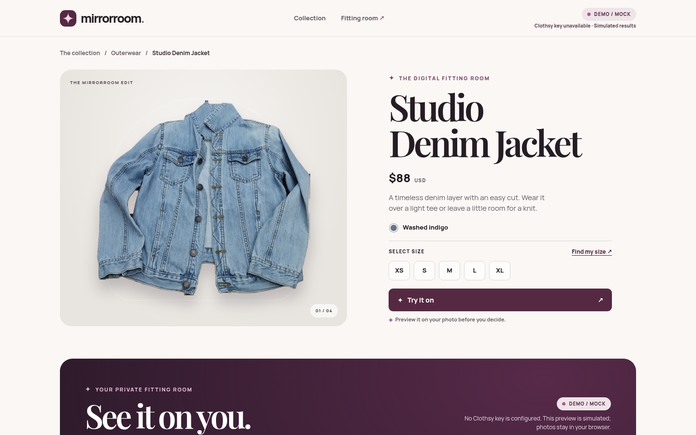
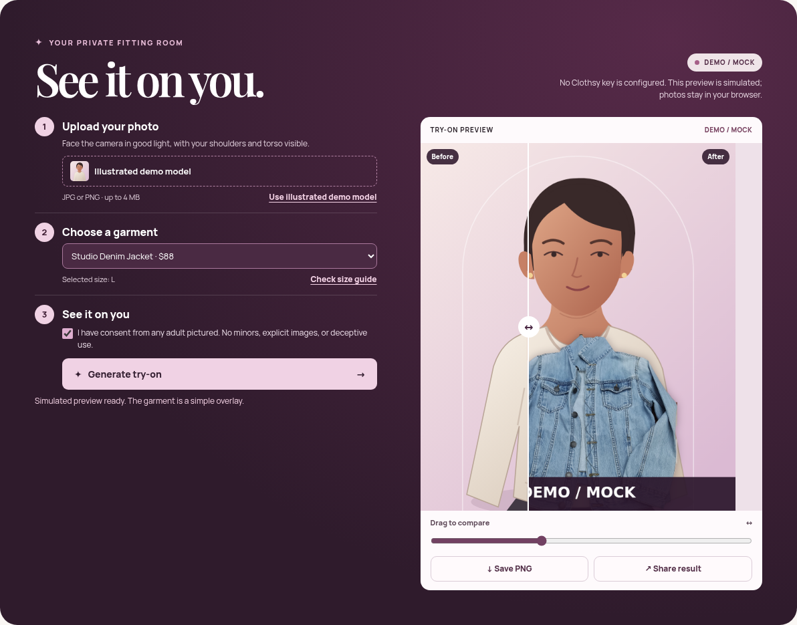

# Mirrorroom

**HackTheFashion Global ’26 · Try-On Commerce**

[Open the GitHub Pages demo](https://zq051031.github.io/hackthefashion-2026/) · [Download the demo video](docs/demo/mirrorroom-demo.mp4) · No account or key needed

Mirrorroom puts the fitting room on the product page. Shoppers can see a garment on their own photo and check its size chart before deciding what to buy. The visualization helps with styling; the measurements help with sizing. Neither is a guarantee of fit. The catalog and prices are illustrative; there is no checkout or payment.



## Try it

1. **Upload your photo.** Use a front-facing JPEG or PNG up to 4 MB, or use the illustrated model in demo mode.
2. **Choose a garment.** Pick a catalog item with its own sizes and prices, or upload a front-facing garment photo.
3. **See it on you.** Confirm consent and generate a result. The fitting room shows when the preview is still being prepared and brings the finished comparison into view on mobile. Drag the before/after slider, then save or share the PNG. If your browser cannot share files directly, download the image and attach it yourself.

**Find my size** recommends the smallest available size that leaves enough room for the entered chest measurement and preferred fit. It explains the recommendation and shows garment measurements. The size guide is for catalog items only and does not infer measurements from a photo.



[View the mobile product page](docs/screenshots/mobile.png).

## Run locally

Use Node.js 22.12+.

```sh
npm ci
npm run dev
```

Open [http://127.0.0.1:5173](http://127.0.0.1:5173). This starts Vite and the local Node API on one origin.

- **No key:** you see **DEMO / MOCK**. The browser makes a simple, watermarked overlay locally. No photos leave the browser in this mode.
- **With a key:** copy `.env.example` to `.env`, fill in `CLOTHSY_API_KEY` with your own key, and restart. You can also export that variable in the shell before starting. Never commit `.env` or put the key in client code or GitHub Pages. The UI shows **Live: Clothsy API** when the server has a key; an invalid key or upstream error is reported, not presented as a successful result.
- **Built local app:** run `npm run build` and then `npm start`. Open [http://127.0.0.1:4173](http://127.0.0.1:4173). Use the same `.env` setup for live mode.

### Clothsy integration

The server uses the official `clothsy-ai` SDK. It uploads both images with `images.upload` (for catalog items it loads the local catalog file), calls `tryons.create` (Bearer-authenticated `POST /api/v1/tryons`), then calls `tryons.waitFor` to poll for the result. The [official documentation](https://clothsyai.fabricvton.com/docs/api) is on `clothsyai.fabricvton.com` and gives the API origin as `https://api.clothsyai.fabricvton.com/api/v1`. The SDK uses that API origin by default. Image uploads are free; Clothsy charges **one credit per completed try-on**. A real account/key and credits are needed for a live result. Without a real key, the successful and rejected-authentication responses are tested against a local test double, not against Clothsy.

### GitHub Pages

`npm run build:pages` generates a static build in `dist/` for `/hackthefashion-2026/`. The build is pushed to the root of the `gh-pages` branch, including `.nojekyll`. A repository admin can activate it in **Settings → Pages → Build and deployment**: choose **Deploy from a branch**, select **gh-pages / (root)**, and save. Pages cannot run Node, so the hosted app is intentionally **DEMO / MOCK** even if you have a key locally. No paid hosting is required.

### Safety & privacy

Use only photos of consenting adults. No images of minors, explicit content, or deceptive use. In live mode the photo and garment are sent to Clothsy. Clothsy documents that its generated image URLs are public and expire after 24 hours; the app does not publish those URLs or automatically share images. Share only with the subject’s permission.

### Checks

```sh
npm test
npx playwright install chromium
npm run test:browser
npm run build:pages
```

To use an installed Chrome, set `CHROME_EXECUTABLE` to its executable path. To regenerate the screenshots, set `CAPTURE_DOCS=1` when running the browser tests.

## Image credits

The model in demo mode is an original illustration of a fictional adult. Product photos were cropped and their backgrounds removed. The garment names, measurements, and prices are fictional and do not describe the original items.

| File | Source & license |
| --- | --- |
| `denim.png` | [Jean jacket.jpg](https://commons.wikimedia.org/wiki/File:Jean_jacket.jpg), NikosLikomitros, [CC0](https://creativecommons.org/publicdomain/zero/1.0/) |
| `hoodie.png` | [Hoodie m7agar.jpg](https://commons.wikimedia.org/wiki/File:Hoodie_m7agar.jpg), YoussefTahoun, [CC0](https://creativecommons.org/publicdomain/zero/1.0/) |
| `bomber.png` | [MA-1 Jacket in petrol.jpg](https://commons.wikimedia.org/wiki/File:MA-1_Jacket_in_petrol.jpg), Spuggie, [CC BY 2.5](https://creativecommons.org/licenses/by/2.5/) |
| `tee.png` | [Red-t-shirt-.jpg](https://commons.wikimedia.org/wiki/File:Red-t-shirt-.jpg), 66saeedz, [CC BY-SA 4.0](https://creativecommons.org/licenses/by-sa/4.0/); the cropped PNG is shared under the same license |

Manrope and Playfair Display are distributed under the included [Manrope OFL](public/fonts/manrope-OFL.txt) and [Playfair Display OFL](public/fonts/playfairdisplay-OFL.txt).
